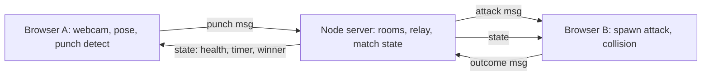

# AGENTS.md — Perfect Punch: Multiplayer MVP

Read `CLAUDE.md` first for how the single-player game works. This file covers **what we are building next** (two players fighting each other online) and **how the agent team works** on it.

## 0. Hard rules (read before anything else)
- **All work happens on the `ariuka` branch.** Every subtask branch is cut from `ariuka` and merges back into `ariuka`.
- **Never touch `main`.** No commits, merges, rebases, or pushes to `main`. No force pushes anywhere.
- **MVP first, deadline-driven.** Ship the smallest playable 1v1. Anything not in section 3 is a stretch goal.
- Solo mode must keep working. Multiplayer is an added mode, not a replacement.
- Don't change the model or the pose pipeline (`web/pipeline.js`, `punch_model.onnx`, `models/`). See "Model and pipeline must match training" in `CLAUDE.md`.

## 1. Goal and acceptance criteria
**Goal:** two players, each in their own browser with their own webcam, join the same room and fight. Your detected punches become attacks on your opponent's screen; they dodge or block them. First to drain the other's health (or highest health when the timer ends) wins.

**MVP acceptance criteria**
1. Player A creates a room and gets a short join code; Player B joins with it. Both see "connected" and the opponent's name.
2. A synced countdown starts the match on both clients at the same time (within ~200 ms).
3. When A throws a punch the detector recognises (`PunchDetector` event, optionally confirmed by the CNN), B's screen spawns the matching attack within ~300 ms: jab → jab circle at the head, hook → hook band, uppercut → uppercut band (shapes from `defense` in `web/game.js`).
4. B's client decides Hit / Block / Dodge with the existing `checkCollision` logic and reports it. Both clients show the same outcome.
5. Each player has a health bar (start 100). Hit = −10 (tunable), Block = −2, Dodge = 0. Both clients show the same health for both players.
6. Match ends at 0 health or after `MATCH_DURATION_S` (default 90 s). Both clients show the same winner screen with a rematch button.
7. Disconnect handling: if a player drops, the other sees "Opponent disconnected" and returns to the lobby. No crash.
8. Solo mode (current game) still starts and plays exactly as before.
9. Runs locally with one command and works across two machines on the same network (or via a public tunnel such as `ngrok`; webcam needs HTTPS or `localhost`).

## 2. Architecture



- **Transport:** WebSocket (`ws` package) on a small Node 20 server. Simple and good enough for MVP. WebRTC video is stretch only.
- **Server (`server/`)** is the referee for *match state*: rooms, join codes, countdown start time, health, timer, winner. It relays punches as attacks and applies outcomes.
- **Defender's client is authoritative for hit/block/dodge**, because only it has that player's landmarks. The server trusts reported outcomes (no anti-cheat for the hackathon).
- **Latency:** the existing attack warning phase (`ATTACK_WARNING_S` = 0.9 s) absorbs network lag. Attacks start their warning when the message *arrives*, not when the punch was thrown.
- **Attack spacing:** keep the defender's existing rule that only one attack is active at a time; queue incoming attacks (max queue 2, drop extras) and keep a minimum gap of `ATTACK_MIN_GAP_S` (~0.4 s). Optionally rate-limit attacks per sender on the server (e.g. 1 per 0.6 s).
- **Offense targets in multiplayer:** MVP turns off the osu!-style prompted targets in versus mode. Your punches are your offense. (Stretch: prompted targets that grant a "power punch".)
- **The server also serves `web/` statically**, so one `npm start` runs everything at http://localhost:8080.

### Message protocol (JSON over WebSocket, every message has `type`)
Client → server
- `create_room {name}` → `room_created {code, playerId}`
- `join_room {code, name}` → `room_joined {code, playerId, opponent}` / `error {reason}`
- `ready {}`: both ready → server sends `match_start {startAt, durationS, players}` (`startAt` = server epoch ms + 3000)
- `punch {kind: "jab"|"hook"|"uppercut", side: "L"|"R", conf, t}`
- `outcome {attackId, result: "Hit"|"Block"|"Dodge"}`
- `rematch {}`

Server → client
- `attack {attackId, kind, from}` (to the defender only)
- `state {health: {id: n}, remainingS, events: [...]}` after each outcome
- `match_end {winner, reason: "ko"|"time"|"disconnect", health}`
- `opponent_left {}`

Clock sync: on connect, the client does a few ping/pong exchanges (`ping {t}` → `pong {t, serverT}`) and keeps an offset, used only to start the countdown in sync.

## 3. MVP subtasks (file ownership and order)

`web/game.js` is one 700-line file, so parallel implementers would collide. **T1 runs first and alone**; after it, T2–T5 can run in parallel because they own separate files.

| ID | Subtask | Owns (may edit) | Depends on |
|---|---|---|---|
| T1 | Split `web/game.js` into modules with **no behaviour change**: `web/config.js` (constants), `web/defense.js` (Attack, spawnAttack, checkCollision, defense object, plus a new `defense.enqueue(kind)` for external attacks), `web/render.js` (drawing helpers, HUD), `web/offense.js` (targets, stepRound), `web/game.js` (init, loop, mode switch) | `web/*.js` except `pipeline.js`, `punchDetector.js` | — |
| T2 | Node server: rooms, codes, relay, match state, timer, health, rematch, disconnects, static serving of `web/` | `server/**`, root `package.json` | — (uses the protocol above) |
| T3 | Client network layer: connect, clock sync, typed send/receive, reconnect-free MVP | `web/net.js` | protocol only |
| T4 | Versus mode game logic: map own punch events to `punch` messages (debounce, one per detected punch), feed incoming `attack` into `defense.enqueue`, send `outcome`, apply `state`/`match_end` | `web/versus.js` | T1, T3 |
| T5 | Lobby and match UI: Solo / Create / Join panel, join code display, ready button, both health bars, opponent name, winner screen, rematch, "opponent disconnected" | `web/index.html`, `web/lobby.js`, HUD additions in `web/render.js` (coordinate with T1 owner; run after T1 merges) | T1 |
| T6 | Tests: `node --test` for server room/match logic and protocol, plus pure client logic (punch→attack mapping, health math) | `server/test/**`, `web/test/**` | T2, T4 |
| T7 | Docs: update `CLAUDE.md` "Web version" with multiplayer run steps; keep this file current | `CLAUDE.md`, `AGENTS.md` | after integration |

**Stretch (only after MVP is merged into `ariuka`):** WebRTC opponent video as picture-in-picture; prompted targets that grant power punches; spectator link; deploy (Render/Fly/Railway for the server, any HTTPS host for `web/`); per-player calibration of attack sizes.

## 4. How to run and verify (every agent uses these exact commands)
```bash
# install (Node 20+)
npm install

# run server + web client at http://localhost:8080
npm start

# automated tests
node --test

# pose pipeline still matches Python (must stay green; don't change pipeline.js)
node web/tools/check_pipeline.mjs
```
**Manual playtest (required for any gameplay change):** open http://localhost:8080 in two browser windows (or two machines via a tunnel), create and join a room, play one full match, and confirm acceptance criteria 1–8. Write down what you checked in your report.

**Known gaps:** no linter, formatter, type checker, or CI exists yet. Don't add heavyweight tooling for the MVP. If you add a check, add its command here.

## 5. Agent team
This repo uses the multi-agent setup below. The Orchestrator plans and delegates; it doesn't write production code. For a small, tightly coupled change, a single implementer plus one independent reviewer is fine.

| Role | Job | Access |
|---|---|---|
| Orchestrator | Plans, delegates with task briefs, tracks status (pending / in progress / blocked / done), merges into `ariuka` | Read, delegation |
| Researcher | Explores code and docs, returns a one-page summary with `path:line` citations, verified vs inferred | Read-only |
| Implementer (1+) | Does exactly one subtask from section 3, only in its owned files | Read all; write only owned files, in its own worktree |
| Tester | Writes tests from the acceptance criteria (not from the implementation), runs them, reports exact output | Read; write test files only; run commands |
| Reviewer | Reviews the diff against the spec: correctness, edge cases, security, latency/perf, conventions, test quality, scope creep | Read-only; may run checks |
| Debugger (optional) | Reproduces failures, tests hypotheses, reports root cause; fixes only if assigned | Read; run commands |
| Docs (optional) | Updates docs to match final behaviour | Docs only |

### Operating principles
1. Narrow roles with their own context. 2. Structured handoffs (formats below), never raw transcripts. 3. Tests, builds, and playtests decide correctness, not opinions. 4. The verifier is never the author and re-runs checks itself. 5. Parallel implementers never edit the same file. 6. Least privilege. 7. Every fix loop is capped at **3** attempts, then escalate. 8. Human approves the plan before implementation and reviews the final diff before merge.

### Workflow
1. Intake (restate goal and criteria) → 2. Research → 3. Plan (human approves) → 4. Implement in parallel worktrees → 5. Test → 6. Review → 7. Fix loop (max 3) → 8. Orchestrator merges into `ariuka`, Tester re-runs everything on the merged result → 9. Report to the human.

A subtask is **done** only when the Tester and the Reviewer have both reported on it.

### Git and isolation
- Base branch: **`ariuka`**. Never `main`.
- One branch per subtask: `agent/<task-id>-<short-name>` (e.g. `agent/T2-server`), created from `ariuka`, ideally with `git worktree add ../pp-T2 -b agent/T2-server ariuka`.
- Small, focused commits with clear messages. No force pushes. No pushes to `main`.
- Only the Orchestrator merges, only into `ariuka`, and only after Tester and Reviewer sign off.
- If two subtasks must touch the same file, run them one after the other.

### Verification gates (on the merged `ariuka` result)
1. `npm start` serves the game with no console errors. 2. `node --test` passes. 3. `node web/tools/check_pipeline.mjs` passes. 4. Manual two-window playtest covers acceptance criteria 1–8. 5. Reviewer approved, with no open blocker or major findings. 6. Every acceptance criterion maps to evidence (a test, command output, or a written playtest note).

### Escalate to the human when
Requirements are unclear or conflict; the same failure survives 3 fixes; you need credentials, new dependencies beyond `ws` (and optionally `express`), or deploy access; tests would have to be deleted or weakened; or a change would touch the model, the pipeline, or `main`. State the problem, what you tried, and the options.

## 6. Handoff formats
**Task brief (Orchestrator → agent)**
```
Task: <one-sentence goal>
Context: <what to know; link to Researcher summary>
Scope: <files you may edit; files you must not touch>
Acceptance criteria:
- <objective, checkable>
How to verify: <exact commands>
Constraints: <style, deps, performance, security>
Return: <report format>
```
**Implementer report**
```
Status: done | blocked | partial
What changed: <files + one line each>
What I ran: <commands and results>
Not verified: <untested or assumed>
Open questions: <decisions needed>
Risks: <what the Reviewer should look at>
```
**Tester report**
```
Verdict: pass | fail | flaky
Tests added or changed: <list>
Commands run: <exact>
Results: <exact output for failures; counts for passes>
Gaps: <not covered and why>
```
**Reviewer report**
```
Verdict: approve | request changes
Findings:
- [blocker|major|minor|nit] path:line - problem - suggested direction
Positive notes: <optional>
```

## 7. Starter prompts
- **Researcher:** You are a read-only codebase researcher. Explore the code and docs relevant to the task and return a one-page summary of relevant files, conventions, constraints, and risks, with `path:line` references. Separate verified facts from inferences. Don't edit anything or propose a full solution.
- **Implementer:** You implement one subtask from AGENTS.md section 3, on your own branch off `ariuka`. Edit only the files your brief lists. Follow existing conventions (pinned CDN imports, the `try/except ImportError` pattern in Python, mirrored-display drawing rules from `CLAUDE.md`). Make the smallest change that meets the criteria and run the section 4 commands before reporting. Never claim something works unless you ran it. If you need to leave your scope, stop and ask.
- **Tester:** You verify work with executable evidence. Write `node --test` tests from the acceptance criteria, cover edge cases (bad join code, full room, disconnect mid-match, health floor at 0, simultaneous KO) and regressions in solo mode, run the suite yourself, and report exact commands and output. Never modify production code, and never weaken or delete tests without flagging it.
- **Reviewer:** You review a diff against its spec with fresh eyes. Check correctness, edge cases, security (validate every incoming WebSocket message, cap message size, no secrets in the repo), latency and frame-loop performance (no blocking work in `loop()`), conventions, test quality, and scope creep. Return findings with severity, `path:line`, and a direction. Don't rewrite code. End with a clear verdict.
